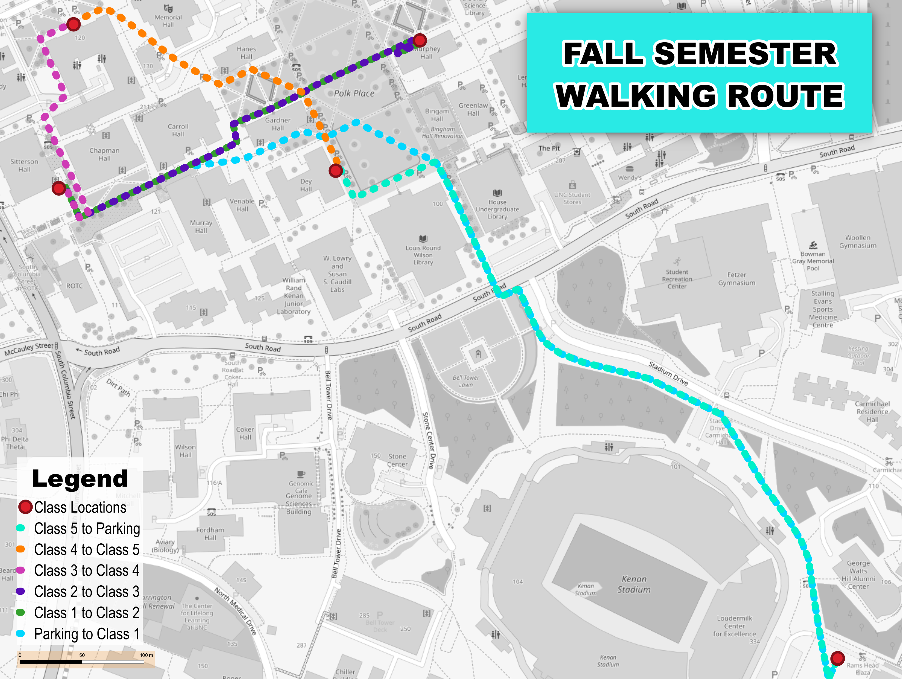

# UNC Chapel Hill Pedestrian Routing Model

An applied spatial data project modeling pedestrian infrastructure and optimized transit routing across the University of North Carolina at Chapel Hill campus. 

*(Above: Mathematically optimized pedestrian routing between Computer Science and Political Science facilities).*

## Project Overview
Pedestrian infrastructure is foundational to modern urban and campus transit planning. This project utilizes OpenStreetMap (OSM) data and QGIS network analysis to evaluate the mathematical efficiency of a daily academic transit route. By mapping exact coordinate nodes against the existing physical pathway network, this model visualizes the most efficient pedestrian route through a dense, high-traffic university environment.

## The Why
Being my first GIS project, I wanted to start with something simple and relatable, but able to be extrapolated to a broader mission. In this case, I used my current class schedule and created a map that visuals my most efficent walking paths. This same design could be use for planning transit stops. Moreover, if more data is pulled in, it could be applied to where polling locations should be, business with high foot traffic, and more.  

## Technical Methodology

### 1. Spatial Data Acquisition
*   Queried and extracted raw spatial vector data from the OpenStreetMap database using the QuickOSM plugin.
*   Filtered the dataset to isolate walkable infrastructure (`highway = footway`, `path`, `pedestrian`) to build a complete pedestrian routing network.

### 2. Network Analysis & Routing
*   Established precise geographical point nodes (start/end destinations) representing specific academic building entrances across the UNC campus.
*   Executed QGIS Network Analysis algorithms (Shortest Path point-to-point) to calculate the mathematically optimal route between each node based on the physical constraints of the pathway grid.

### 3. Cartographic Design
*   **Basemap Styling:** Applied luminosity-based grayscale rendering to the OSM basemap to minimize visual noise and emphasize primary data.
*   **Vector Scaling:** Configured route line symbology using real-world map units (Meters at Scale) rather than screen pixels, ensuring the data maintains accurate geographical proportions regardless of layout scaling.

## Tools & Technologies
*   **Software:** QGIS (Quantum GIS)
*   **Data Sources:** OpenStreetMap (OSM)
*   **Techniques:** Vector Data Management, Geoprocessing, Spatial Network Analysis, Cartography

## Future Scope for Analysis
While this iteration calculates optimization based purely on horizontal distance, future expansions of this model could incorporate:
*   **Topography:** Integrating an understanding of elevation to estimate exact travel times based on campus slope and elevation changes.
*   **Accessibility Planning:** Classifying path networks by ADA compliance (e.g., stairs vs. ramps) to model inclusive routing options.
